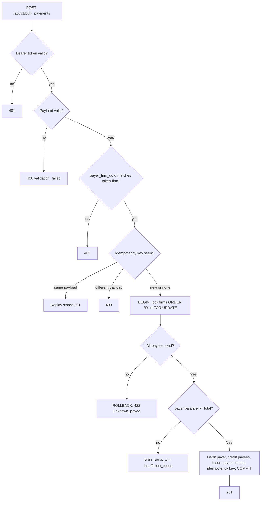

# Bulk Payment Service: Implementation Plan

A Rails 8 API-only bulk-payment service backed by PostgreSQL and run with Docker Compose. Payments are atomic and protected against concurrent overdraft with row locks, callers authenticate with per-firm API keys bound to the payer, idempotency keys are stored in the database, there is a layered folder structure, central error handling, and RSpec tests that focus on the money paths.

## 1. Requirements: what the PDF specifies, plus additions and assumptions

What the PDF specifies:
- `POST` a bulk payment request from one payer firm.
- If the payer can't cover the total, deny the whole request with **422**.
- Otherwise insert the payments, debit the payer, credit each payee, and return **201**.
- The server runs as multiple load-balanced instances on a relational database.
- The service ships with a README, commit history and the raw AI logs.

Additional requirements:
- Ruby, a REST API, PostgreSQL, Docker and Docker Compose.
- Code layered by responsibility (routing, services, data access, validation, utilities).
- Authentication bound to the payer.
- Schema and seed data delivered as migrations.
- Unit tests.
- Standard framework logging with log levels.
- 4xx for client errors and 5xx for server errors, with details hidden from the response.
- An AI rules file.

The gaps the PDF leaves open, and how they are filled (each is listed as an assumption in the README):
- **Amount format:** must match `\A\d+(\.\d{1,2})?\z` and be greater than 0. It is converted to cents with `BigDecimal` and never touches a float. Requests are capped at 1000 payments.
- **Description:** required, not blank, at most 1000 characters.
- **Same payee twice in one request** (the sample does this): allowed, and the payee's credits are summed.
- **Payer paying itself:** rejected with 400.
- **Unknown payee:** the whole request is denied with 422 `unknown_payee`. This is a business-level denial, because it needs a database lookup.
- **Column types:** `balance_cents` and `amount_cents` become `bigint`. Postgres `INTEGER` tops out at about $21.4M, which a large firm's balance could exceed. Database CHECK constraints enforce `balance_cents >= 0` and `amount_cents > 0` as a last line of defense.
- **201 response body:** the created payments (id, payee uuid, amount, description) plus the payer's new balance.

## 2. How running multiple load-balanced instances affects the design

Database transactions are necessary, but on their own they aren't enough:
- **Concurrent overdraft.** Two requests from the same payer can land on two different instances. At Postgres's default READ COMMITTED isolation, both can read the same balance and both can pass the funds check. In-process mutexes can't help, because the instances don't share memory. The fix is to lock the payer and payee rows with `SELECT ... FOR UPDATE` inside the transaction, re-check the balance after the lock is held, and keep the CHECK constraint as a backstop.
- **Deadlocks.** If A pays B while B pays A, each transaction can hold one row and wait for the other. The fix is to lock every involved firm in a single query, `WHERE uuid IN (...) ORDER BY id FOR UPDATE`, so locks are always taken in the same order. A `SET LOCAL lock_timeout` bounds the wait, and a lock timeout returns 503.
- **Retries creating duplicate payments.** When a client or the load balancer retries after a timeout, the retry may reach a different instance and pay twice. The fix is an optional `Idempotency-Key` header. Keys are unique per firm and stored in the database, and the key row is written in the same transaction as the payments. A replay returns the stored 201. Reusing a key with a different payload returns 409. If two requests with the same key race, the unique index rejects the second; it rolls back and returns the stored response.
- **Stateless instances.** There are no sessions and no in-memory caches. API keys are checked against the database on every request.
- **Migrations.** A one-off `migrate` container runs them once; the API replicas don't run them at boot. Rails also takes an advisory lock while migrating.
- **Operations.** Logs go to stdout, tagged with `X-Request-Id` so a request can be traced across instances. `GET /up` is the health check for the load balancer. Database connections must stay within `instances x RAILS_MAX_THREADS <= max_connections`.
- **Out of scope** (listed as README improvements): an nginx multi-replica demo, shared rate limiting with Redis or at the load balancer, concurrency tests, and PgBouncer.

## 3. Stack

- **Ruby 3.4 and Rails 8 in API-only mode.** It is the most widely used Ruby web framework. ActiveRecord provides transactions, `lock` and migrations; Rails provides the standard logger, request IDs and `rescue_from`.
- **Gems:**
  - `pg` and `puma` for the database driver and web server.
  - `dry-validation` for the nested payload validation.
  - `rspec-rails`, `factory_bot_rails` and `shoulda-matchers` for tests.
  - `rubocop-rails-omakase`, which Rails 8 includes by default.
- **Running locally:** all tooling runs inside the `ruby:3.4` image.

## 4. Request flow



## 5. Project layout

```
app/
  controllers/application_controller.rb       # rescue_from maps errors to HTTP statuses
  controllers/concerns/authenticatable.rb     # Bearer token -> current_firm
  controllers/api/v1/bulk_payments_controller.rb
  validators/bulk_payment_contract.rb         # dry-validation contract
  services/auth/authenticate_api_key.rb
  services/payments/create_bulk_payment.rb    # transaction, locking, debit/credit
  services/payments/idempotent_execution.rb
  repositories/firm_repository.rb             # lock_by_uuids, debit!, credit!
  repositories/payment_repository.rb          # insert_all
  repositories/api_key_repository.rb
  repositories/idempotency_key_repository.rb
  models/{firm,payment,api_key,idempotency_key}.rb
  errors/                                     # AppError subclasses carrying status and code
  utils/money.rb                              # "1200.75" <-> 120075 cents
config/routes.rb                              # POST /api/v1/bulk_payments, GET /up
db/migrate/                                   # schema and seed data migrations
lib/tasks/api_keys.rake                       # generate a key for a firm and print it once
spec/{utils,validators,services,repositories,requests}/
Dockerfile, docker-compose.yml, AGENTS.md, README.md, docs/ai-logs/
```

## 6. Database migrations

- **`firms`:** `name`, `balance_cents bigint` (CHECK >= 0), `uuid` (unique index), timestamps.
- **`payments`:** `payer_firm_id` and `payee_firm_id` (foreign keys, indexed), `amount_cents bigint` (CHECK > 0), `description text`, `created_at`.
- **`api_keys`:** `firm_id` (foreign key), `token_digest` (unique; SHA-256 of a high-entropy random token), `revoked_at`, timestamps.
- **`idempotency_keys`:** `firm_id`, `key`, `request_digest`, `response_status`, `response_body jsonb`, `created_at`, with a unique index on `(firm_id, key)`.
- **Seed data migration:** inserts the 3 firms from the spec with their explicit ids and uuids, then resets the `firms` id sequence with `setval`. It also inserts digests of demo API keys; the plaintext keys go in the README and are for development only.

## 7. Security, errors and logging

**Security**
- Requests send `Authorization: Bearer <token>`.
- The token is looked up by its digest. A revoked key is rejected.
- The authenticated firm must own `payer_firm_uuid`. If it doesn't, the response is 403, and nothing reveals whether the uuid belongs to a real firm.
- `filter_parameters` keeps tokens out of the logs.

**Error responses**
- The body is always `{ "error": { "code", "message", "details"?, "request_id"? } }`.
- **400:** malformed JSON, `validation_failed` (with details per field), or a payer paying itself.
- **401:** missing, invalid or revoked token, with a `WWW-Authenticate: Bearer` header.
- **403:** the token's firm doesn't own the payer uuid.
- **409:** an idempotency key reused with a different payload.
- **422:** `insufficient_funds` or `unknown_payee`.
- **503:** lock timeout.
- **500:** any other error returns a generic message and the `request_id`. The full exception and backtrace are logged at `error` level.

**Logging**
- Uses the standard Rails tagged logger, writing to stdout. The level comes from the `LOG_LEVEL` environment variable.
- `debug`: validation details.
- `info`: an accepted batch, with the payer id, number of payments and total.
- `warn`: 4xx denials and auth failures.
- `error`: 5xx errors.

## 8. Tests (RSpec)

- **Unit tests:**
  - `Money` parsing: edge cases such as `0`, `-1`, `1.234`, `1e3`, whitespace and very large values.
  - `BulkPaymentContract`.
  - `AuthenticateApiKey`.
  - `CreateBulkPayment`: the spec's sample produces the exact expected balances; spending exactly the full balance succeeds; insufficient funds rolls back with no payments and unchanged balances; unknown payee; a duplicate payee's credits are summed.
  - Idempotency: replay returns the stored response, a different payload returns 409.
  - Repositories.
- **Request specs:** 201 with the sample request; 422 for each denial; 400 for malformed and invalid payloads; 401; 403; and a 500 whose body leaks nothing when the service is stubbed to raise.

## 9. Docker

- **`Dockerfile`:** multi-stage, with a `production` target and a `test` target that includes the dev and test gems.
- **`docker-compose.yml`:**
  - `db` runs `postgres:16-alpine`, with a healthcheck and a volume.
  - `migrate` runs `bin/rails db:prepare` once.
  - `api` listens on port 3000 and starts only after `migrate` completes successfully.
  - `test`, under a profile, runs `bundle exec rspec` against a test database.

## 10. AI rules and deliverables

- **`AGENTS.md`** (Cursor reads it, and it isn't tied to any one tool) sets these rules:
  - Prefer common libraries.
  - Keep code concise and clear, with no unnecessary comments.
  - Respect the layer boundaries.
  - Money is always integer cents, never floats.
  - All balance changes go through the service, inside a transaction with ordered locks.
  - Every change to money logic needs tests.
  - Never leak internal errors in responses.
  - Keep commits small and logical.
- **`README`** follows the PDF's outline: solution and approach, issues, assumptions, improvements, how to run and verify (curl commands with the demo keys), the two closing questions, and the AI tools used.
- **AI logs:** raw chat transcripts exported to `docs/ai-logs/` at the end.
